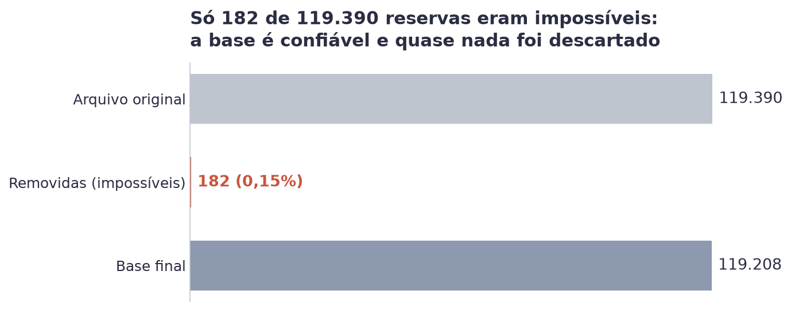
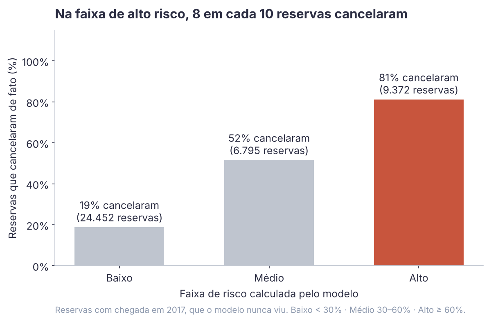

# data.reserva — Quem vai cancelar a reserva?

> **Em uma frase:** quase 4 em cada 10 reservas dos dois hotéis estudados são canceladas.
> Este projeto usa o histórico de reservas para entender **por que** isso acontece, **prever**
> quais reservas têm mais chance de cancelar e **recomendar** o que a gerência pode fazer a respeito.

<!-- SEÇÃO: RESUMO EXECUTIVO — Gabriel (#5) -->
**O problema:** quase 4 em cada 10 reservas (37%) dos dois hotéis são canceladas, o que deixou
**€ 16,7 milhões** em quartos vazios em pouco mais de 2 anos.
**O que descobrimos:** cancelam mais as reservas feitas com muita antecedência e as "não
reembolsáveis"; cancelam menos os hóspedes que fazem pedidos especiais.
**O que o radar de risco faz:** dá a cada reserva uma nota (baixo, médio ou alto). Em 2017, na faixa
alta, **81%** cancelaram; ela tem 23% das reservas e 48% dos cancelamentos.
**Quanto pode valer:** cerca de **€ 0,67 milhão** em 8 meses, se o hotel recuperar 20% (estimativa).
**O que recomendamos:** um piloto de **3 meses** no Hotel de cidade, agindo sobre a faixa alta.
<!-- FIM: RESUMO EXECUTIVO -->

---

## Para quem é este trabalho

Para a **gerência de dois hotéis em Portugal** (um hotel de cidade e um resort), que não tem
formação técnica. Tudo aqui é escrito para ser entendido por essa pessoa: frases curtas,
exemplos concretos e números em contexto ("4 em cada 10 reservas"), não jargão.

## A pergunta de negócio

**"Quais reservas têm alta chance de serem canceladas e o que podemos fazer, antes da chegada
do hóspede, para não perder a receita desses quartos?"**

## Como o trabalho foi organizado (CRISP-DM)

Seguimos as 6 fases do CRISP-DM, um roteiro padrão de projetos de dados: entender o negócio,
entender os dados, preparar os dados, construir o modelo, avaliar e colocar em uso.

| Fase do CRISP-DM | O que responde | Entrega | Responsável |
|---|---|---|---|
| 1. Entendimento do negócio | Qual é o problema e o que é sucesso? | [`docs/01_entendimento_do_negocio.md`](docs/01_entendimento_do_negocio.md) | Igor (#2) |
| 2. Entendimento dos dados (EDA) | O que os dados mostram? | [`notebooks/02_entendimento_dos_dados.ipynb`](notebooks/02_entendimento_dos_dados.ipynb) | Adrian (#3) |
| 3. Preparação dos dados (ETL) | Os dados são confiáveis? | [`notebooks/01_etl_preparacao_dos_dados.ipynb`](notebooks/01_etl_preparacao_dos_dados.ipynb) · [`src/etl.py`](src/etl.py) | Igor (#2) |
| 4. Modelagem (análise preditiva) | Dá para prever o cancelamento? | [`notebooks/03_modelo_preditivo.ipynb`](notebooks/03_modelo_preditivo.ipynb) | Renato (#4) |
| 5. Avaliação | O modelo é bom o bastante para o hotel? | [`notebooks/03_modelo_preditivo.ipynb`](notebooks/03_modelo_preditivo.ipynb) (parte final) | Renato (#4) |
| 6. Implantação + Data Storytelling | Como usar no dia a dia e como contar a história? | [`docs/06_implantacao.md`](docs/06_implantacao.md) · [`apresentacao/`](apresentacao/) | Gabriel (#5) |

O planejamento completo está na issue #1.

---

<!-- SEÇÃO: 1 ENTENDIMENTO DO NEGÓCIO + 3 PREPARAÇÃO — Igor (#2) -->
## 1. O problema do hotel

Os dois hotéis recebem muitas reservas, mas uma parte grande delas não vira hóspede. Cada
cancelamento, principalmente perto da data, é um quarto vazio, uma receita que não volta e
uma equipe preparada para quem não vem. Em pouco mais de dois anos (julho de 2015 a agosto
de 2017):

| | Hotel de cidade | Resort | Os dois juntos |
|---|---|---|---|
| Reservas | 79.162 | 40.046 | 119.208 |
| **Taxa de cancelamento** | **42%** | **28%** | **37%** (quase 4 em cada 10) |
| Receita estimada das canceladas | € 10,9 milhões | € 5,8 milhões | **€ 16,7 milhões** |

Os € 16,7 milhões são **39%** de toda a receita reservada (diária × noites). O objetivo é
dar a cada reserva uma **nota de risco** (baixo, médio ou alto) para o hotel agir antes da
chegada. Problema, objetivos, critério de sucesso e riscos em
[`docs/01_entendimento_do_negocio.md`](docs/01_entendimento_do_negocio.md).
Números de [`reports/tables/01_resumo_do_problema.csv`](reports/tables/01_resumo_do_problema.csv).

## 3. Preparação dos dados

Antes de analisar, organizamos a bagunça (o chamado ETL: extrair, transformar e carregar).
O que fizemos e por quê:

- **Removemos só o impossível:** 180 reservas com zero hóspedes, 1 com diária negativa e 1
  com diária de € 5.400. São **182** de 119.390 (0,15%).
- **Mantivemos as linhas repetidas** (31.994): sem número de reserva, não dá para provar que
  são erro; em geral são grupos que reservaram vários quartos iguais.
- **Preenchemos os espaços em branco:** crianças em branco viraram 0; país em branco virou
  "Desconhecido"; agência e empresa viraram "tem ou não tem".
- **Tiramos as colunas que "entregam a resposta"**, como a situação final da reserva: elas
  só existem depois do cancelamento e fariam a previsão parecer perfeita sem ser.
- **Traduzimos tudo** para o português e criamos colunas novas: total de noites, total de
  hóspedes e receita estimada.
- **Separamos o passado do futuro:** o modelo aprende com as chegadas até 2016 (78.589
  reservas, o "treino") e é conferido nas de 2017 (40.619, o "teste"), que ele nunca viu.



Quase nada foi descartado: a base final tem **119.208 reservas** e é confiável para as
próximas etapas. O significado de cada coluna está no
[dicionário de dados](docs/dicionario_de_dados.md), e o passo a passo, no
[notebook 01](notebooks/01_etl_preparacao_dos_dados.ipynb).
<!-- FIM: IGOR -->

<!-- SEÇÃO: 2 ENTENDIMENTO DOS DADOS — Adrian (#3) -->
## 2. O que os dados mostram

_A preencher na issue #3._
<!-- FIM: ADRIAN -->

<!-- SEÇÃO: 4 MODELAGEM + 5 AVALIAÇÃO — Renato (#4) -->
## 4. Prevendo cancelamentos

**Dá para saber antes quem vai cancelar? Sim, com boa margem.** O modelo aprendeu com as
**78.589 reservas de 2015–2016** quais combinações de características costumam terminar em
cancelamento e depois foi testado nas **40.619 reservas de 2017**, que ele nunca tinha visto.
Para cada reserva, ele dá uma **chance de cancelamento** e a coloca numa faixa de risco:
**baixo** (menos de 30%), **médio** (30% a 60%) ou **alto** (60% ou mais).

Para valer a pena, o modelo precisava vencer duas comparações simples:

- **"Chute ingênuo"** (dizer que ninguém cancela): acerta 6 em cada 10 reservas, mas **nunca
  avisa um cancelamento**. Mostra por que o "acerto geral" engana.
- **"Regra do gerente"** (cancela se a reserva foi feita com mais de 90 dias de antecedência ou
  com depósito não reembolsável): ajuda, mas de cada 10 avisos só 5 cancelam de fato.

Testamos três modelos e o vencedor foi a **floresta aleatória** (300 "árvores de perguntas"
que votam entre si), com nota F1 de **0,79** nos simulados do treino, contra **0,59** da regra
do gerente ([`03_comparacao_modelos.csv`](reports/tables/03_comparacao_modelos.csv)). O hotel
é avisado quando a chance passa de **37%** (limiar escolhido só com os dados de treino).



Em 2017, as faixas separaram bem as reservas: na faixa **baixa** só **19%** cancelaram; na
**alta**, **81%**. A faixa alta tem **23% das reservas**, mas concentra **48% de todos os
cancelamentos**.

## 5. O modelo é bom o bastante?

**Em frase de gerente (reservas de 2017):**

- **Precisão:** de cada 10 reservas que o modelo marcou como "vai cancelar", **7 cancelaram**
  de fato (regra do gerente: 5).
- **Cobertura (recall):** de cada 10 cancelamentos que aconteceram, o modelo **avisou 6 antes**
  (regra do gerente: 7). Ele avisa um pouco menos, mas erra muito menos; baixando o limiar, o
  hotel pega mais cancelamentos em troca de mais alarmes falsos.
- **Nota F1:** **0,67**, contra **0,58** da regra do gerente.
- **AUC:** **0,84**, ou seja, em 84% das vezes o modelo dá risco maior a uma reserva que cancela
  do que a uma que não cancela.

**O que mais pesa no risco** ([`03_fatores_de_risco.csv`](reports/tables/03_fatores_de_risco.csv)):
tipo de depósito (reservas "não reembolsáveis" cancelam 99% das vezes, um padrão estranho
**para o hotel investigar**), pedidos especiais (quem faz pedidos cancela 19%, contra 47% de
quem não faz), antecedência (60% das reservas feitas com mais de 6 meses cancelam, contra 10%
das feitas na mesma semana) e o segmento de mercado.

**Critério de sucesso** (definido antes de modelar, issue #1):

| Critério | Meta | Resultado | Atingiu? |
|---|---|---|---|
| Acerta mais do que a regra do gerente (nota F1 em 2017) | > 0,58 | 0,67 | **Sim** |
| Na faixa alta, pelo menos 7 de cada 10 cancelam | ≥ 70% | 81,2% | **Sim** |

**Quanto isso pode salvar (simulação com premissas).** Ação proposta para a faixa alta:
contato de confirmação antes da chegada e, sem resposta, liberar o quarto para revenda. As
reservas de alto risco que cancelaram em 2017 somavam **€ 3,34 mi** (46% de toda a receita
cancelada no período). *Premissa:* o hotel recupera só uma parte disso:

| Cenário (premissa) | Receita recuperada em jan–ago/2017 | Por mês |
|---|---|---|
| Pessimista (10%) | € 0,33 mi | ≈ € 42 mil |
| Moderado (20%) | € 0,67 mi | ≈ € 84 mil |
| Otimista (30%) | € 1,00 mi | ≈ € 125 mil |

Na faixa alta, **1.761 reservas (19%)** eram alarme falso: o hóspede veio. Como a ação é só um
contato cordial, o custo é baixo, mas **nenhuma reserva é cancelada só porque o modelo deu
risco alto**.

**Limitações:** dados de 2015 a 2017 (o modelo precisa ser treinado de novo com dados
recentes), só dois hotéis em Portugal, sem informação de fora (preço da concorrência, eventos,
clima) e a simulação de dinheiro é uma estimativa. A nota caiu dos simulados (F1 0,79) para
2017 (F1 0,67), o que é esperado num ano novo; a nota que vale é a de 2017.

**Veredito: pronto para um piloto controlado**, começando por um hotel, com dados recentes e
comparando com um grupo sem contato para medir o ganho real. Detalhes no
[`notebook 03`](notebooks/03_modelo_preditivo.ipynb).
<!-- FIM: RENATO -->

<!-- SEÇÃO: 6 IMPLANTAÇÃO E RECOMENDAÇÕES — Gabriel (#5) -->
## 6. O que o hotel deve fazer

**Toda manhã**, as reservas novas recebem uma nota de risco, e a equipe de reservas recebe a lista de
**alto risco** das chegadas dos próximos 30 dias. A ação depende da faixa:

| Faixa | O que fazer |
|---|---|
| **Alto** (81% cancelaram em 2017) | Contato de confirmação 7 a 14 dias antes, oferecer troca de data em vez de cancelamento e, sem resposta, considerar revenda controlada do quarto |
| **Médio** (52%) | Lembrete automático por e-mail com os serviços do hotel |
| **Baixo** (19%) | Nada muda |

**Piloto:** 3 meses no **Hotel de cidade** (a maior taxa de cancelamento: 42%, contra 28% do
resort), com o resort como comparação. **Acompanhamento mensal:** taxa real de cancelamento por
faixa, receita recuperada e reclamações de hóspedes contatados. O radar deve ser treinado de novo
a cada 3 meses. Cuidados: privacidade (RGPD) e nunca tratar o hóspede como suspeito.

- Plano completo: [`docs/06_implantacao.md`](docs/06_implantacao.md)
- Slides: [`apresentacao/apresentacao.pdf`](apresentacao/apresentacao.pdf) · fonte em [`apresentacao/slides.md`](apresentacao/slides.md)
- Roteiro de fala: [`apresentacao/roteiro.md`](apresentacao/roteiro.md)
- Exemplo de lista diária: [`reports/tables/06_exemplo_lista_diaria.csv`](reports/tables/06_exemplo_lista_diaria.csv)
<!-- FIM: GABRIEL -->

---

## Os dados

119.390 reservas reais de dois hotéis portugueses, com chegadas entre julho de 2015 e agosto
de 2017. Fonte, licença e significado de cada coluna em [`data/README.md`](data/README.md).

## Estrutura do repositório

```
data/raw/            dados originais, nunca alterados (hotels.csv)
data/processed/      dados tratados pelo ETL (reservas_tratadas.parquet)
src/etl.py           funções de extração, transformação e carga
notebooks/           um notebook por etapa, executados e com saídas
reports/figures/     gráficos (PNG) usados no README e na apresentação
reports/tables/      tabelas de resultados (CSV)
docs/                textos das fases do CRISP-DM e dicionário de dados
apresentacao/        slides, PDF final e roteiro de fala
```

## Como rodar

Plataforma: VSCode + Jupyter Notebook (os notebooks também abrem no Google Colab).

```bash
python -m venv .venv
.venv\Scripts\activate          # Windows  (Linux/macOS: source .venv/bin/activate)
pip install -r requirements.txt
jupyter nbconvert --to notebook --execute --inplace notebooks/01_etl_preparacao_dos_dados.ipynb
```

Ordem de execução: `01` → `02` → `03`.

## Convenções do projeto

- **Linguagem para leigo:** cada gráfico tem um título que já diz a conclusão
  (ex.: "Quem reserva com mais de 6 meses de antecedência cancela o dobro"). Termos técnicos,
  quando inevitáveis, vêm explicados em uma frase.
- **Números só com origem:** todo número escrito no README, nos docs ou nos slides vem de uma
  saída de notebook ou de `reports/tables/`.
- **Dados:** sempre ler por `src/etl.py` (`carregar_dados_tratados()`); nunca alterar `data/raw/`.
- **Aleatoriedade:** `SEED = 42` em tudo.
- **Git:** branch `{tipo}/{issue}-{slug}` (ex.: `feat/3-eda`), commits no padrão
  [Conventional Commits](https://www.conventionalcommits.org/pt-br/) em português
  (ex.: `feat(eda): adiciona análise de antecedência`), PR com `Closes #N`, aprovado pelo
  revisor indicado na issue, merge com "Create a merge commit". Nunca commitar direto na `main`.
- Cada integrante edita apenas os próprios arquivos e a própria seção deste README
  (entre os marcadores `<!-- SEÇÃO -->` e `<!-- FIM -->`).

## Equipe

Adrian Cesar Gonçalves (@adrian-cesar) · Gabriel Carvalho (@gabrielcarvallho) ·
Igor Thiago Seberino (@igorSeberino) · Renato Colin Neto (@rcolinneto)
