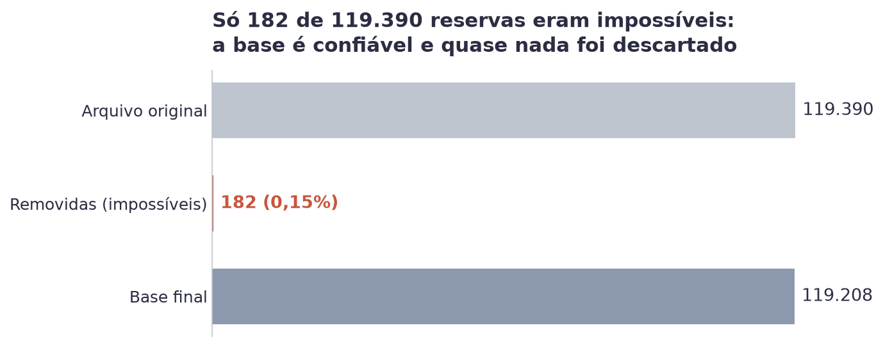
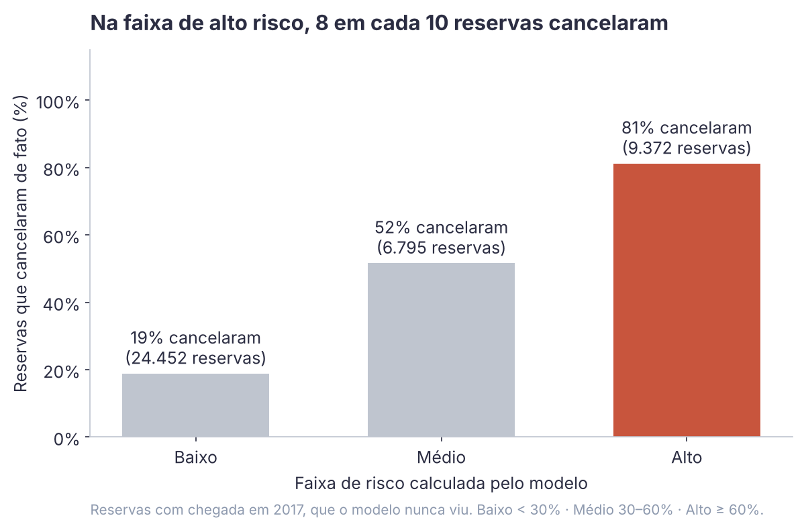
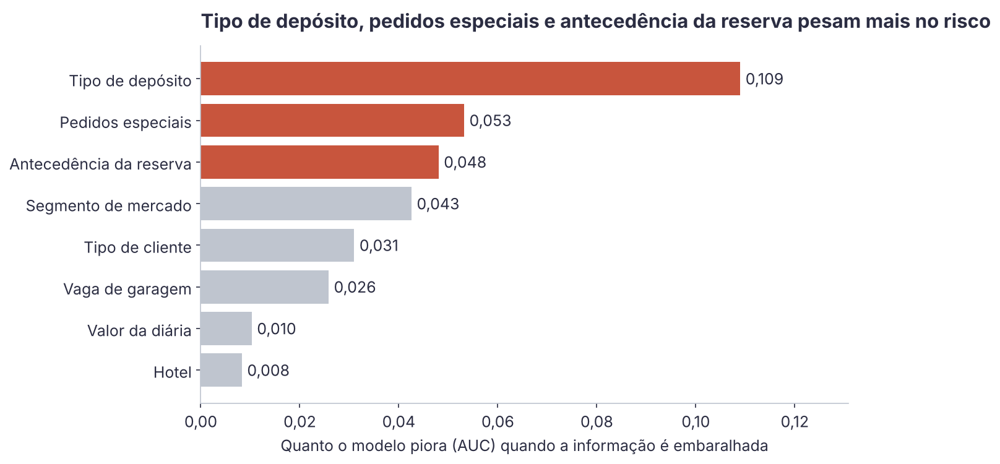

<!-- _class: escuro -->
<!-- _paginate: false -->
<!-- _footer: "" -->

Projeto de análise de dados · Hotelaria

# Quem vai cancelar a reserva?

Um **radar de risco** para os dois hotéis

Adrian Cesar · Gabriel Carvalho · Igor Seberino · Renato Colin

---

O problema

## Quase **4 em cada 10** reservas são canceladas

37%

44 mil das 119 mil reservas, de julho de 2015 a agosto de 2017.

Se cada linha repetida do arquivo contar uma vez só, a taxa é <strong>28%</strong>: ainda mais de 1 em cada 4 reservas.

---

O problema

## **€ 16,7 milhões** em reservas canceladas

  

    
€ 16,7 mi

    
em diárias de reservas que foram canceladas

  

  

    
39%

    
de toda a receita que estava reservada

  

É o valor que <strong>estava reservado</strong> (diária × noites), não o prejuízo: parte pode ter sido revendida ou retida como depósito. Contando as linhas repetidas uma vez só, são € 11,5 mi.

---

Os dados

## Antes de analisar, organizamos **119 mil reservas**

Só **182** eram impossíveis e saíram. O resto ficou.

Cerca de 1 em cada 4 linhas é idêntica a outra. Mantivemos, porque em geral são quartos de um mesmo grupo. O efeito disso foi medido e aparece nas notas.

---

O que os dados mostram

## Quanto mais cedo a reserva, **maior o cancelamento**

**68%** cancelam quando reservam com mais de 1 ano de antecedência. Até 7 dias antes, **10%**.

---

O que os dados mostram

## Histórico, grupos e pedidos **revelam o compromisso**

  

    
92%

    
de quem <b>já cancelou antes</b> cancela de novo

    
contra 34% de quem nunca cancelou

  

  

    
61%

    
das <b>reservas de grupos</b> são canceladas

    
a maior taxa entre os canais

  

  

    
17%

    
de quem faz <b>3 ou mais pedidos especiais</b> cancela

    
contra 48% de quem não faz nenhum

  

---

O que os dados mostram

## Um achado **para o hotel investigar**

**99%** das reservas "não reembolsáveis" cancelam. Isso contraria o esperado.

93% dessas linhas são repetidas. Contando cada uma uma vez só, são cerca de mil reservas, e <strong>95%</strong> delas cancelaram: o padrão continua estranho.

---

A previsão

## **Dá para saber antes:** o radar de risco

Faixa alta: **81%** cancelaram. Faixa baixa: **19%**. Testado em 2017, um ano que o radar nunca viu.

---

A previsão

## O que mais pesa: **depósito, pedidos e antecedência**

O depósito lidera por causa do padrão estranho das reservas "não reembolsáveis". Por isso testamos o radar sem elas (próximos slides).

---

A previsão

## Funciona? **Sim, nos dois critérios**

| Critério definido antes de modelar | Resultado em 2017 |
|---|---|
| Avisa melhor que a regra do gerente (nota F1) | **Sim:** 0,67 contra 0,58 |
| Na faixa alta, pelo menos 7 em cada 10 cancelam | **Sim:** 81% |

"Avisar melhor" quer dizer menos alarme falso: de cada 10 avisos do radar, 7 cancelam (na regra, 5). A regra, porém, encontra um pouco mais de cancelamentos (7 em 10, contra 6 do radar).

---

A previsão · teste de resistência

## E se o depósito estiver errado? **O radar continua melhor**

  

    
0,54 × 0,46

    
nota do radar contra a regra do gerente, <b>sem as reservas "não reembolsáveis"</b>

    
mesmo um radar que nunca viu o depósito chega a 0,54

  

  

    
2 em 3

    
cancelam na faixa alta, sem essas reservas (67%)

    
perto da meta de 7 em 10, mas abaixo dela

  

O radar aprendeu padrões reais (antecedência, pedidos, canal, histórico). A investigação do depósito vai dizer se a faixa alta acerta 8 ou 7 em cada 10.

---

A decisão

## Quanto isso vale? **Até € 0,67 mi em 8 meses**

  

    
€ 0,67 mi

    
com todas as reservas da faixa alta

  

  

    
€ 0,43 mi

    
sem as "não reembolsáveis" (o depósito pode já ter ficado com o hotel)

  

Premissa: o contato recupera 20% da receita das reservas da faixa alta que cancelariam. É estimativa, não promessa: o piloto vai medir o valor real.

---

A decisão

## **A partir de amanhã:** agir conforme a faixa

  

    
Alta

    
Contato de confirmação <b>7 a 14 dias antes</b>, oferecendo outra data em vez do cancelamento

  

  

    
Média

    
Lembrete simpático <b>por e-mail</b>

  

  

    
Baixa

    
Nada muda

  

Piloto de **3 meses** no hotel de cidade, que tem **42%** de cancelamento.

---

<!-- _class: escuro -->
<!-- _footer: "" -->

Próximos passos

# Começar pelo **piloto**

<ol style="font-size:32px; line-height:1.5">
  <li>Investigar as reservas "não reembolsáveis" com a equipe de reservas</li>
  <li>Validar o plano de contato com a equipe</li>
  <li>Atualizar o radar com dados recentes</li>
  <li>Rodar o piloto de 3 meses e comparar com o resort</li>
  <li>Decidir se amplia para o resort</li>
</ol>

<strong>Obrigado!</strong>

