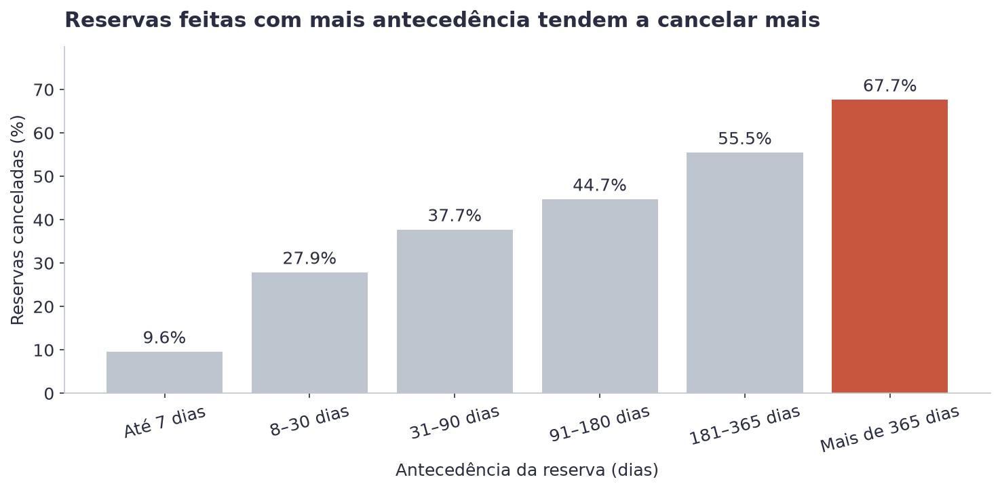
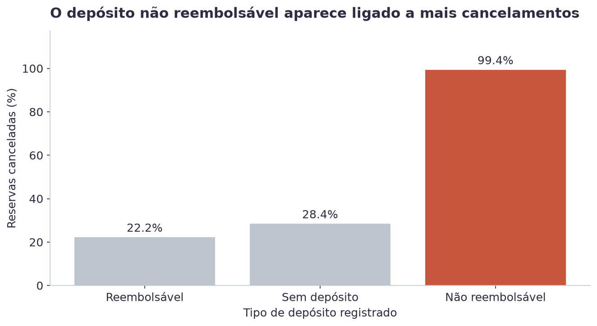

<!-- _class: capa -->
<!-- _paginate: false -->

# Quem vai cancelar a reserva?

Um **radar de risco** para os dois hotéis

Adrian Cesar · Gabriel Carvalho · Igor Seberino · Renato Colin

---

## Quase **4 em cada 10** reservas são canceladas

37%

44 mil das 119 mil reservas, em pouco mais de 2 anos.

---

## Isso deixou **€ 16,7 milhões** em quartos vazios

€ 16,7 mi

São **39%** de toda a receita reservada. Ninguém sabia quem ia cancelar.

---

## Antes de analisar, organizamos **119 mil reservas**

Só 182 eram impossíveis. O resto ficou.

---

## Quanto mais cedo a reserva, **maior o cancelamento**

**68%** cancelam com mais de 1 ano de antecedência. Na mesma semana, **10%**.

---

## Histórico, grupos e pedidos **revelam o compromisso**

- Já cancelou antes: **92%** cancelam de novo (contra 34%)
- Reservas de grupos: **61%** cancelam
- Com 3 pedidos especiais ou mais: **17%** (contra 48% sem pedidos)

---

## Um achado **para o hotel investigar**

**99%** das reservas "não reembolsáveis" cancelam. Isso contraria o esperado.

---

## **Dá para saber antes:** o radar de risco

Faixa alta: **81%** cancelaram. Faixa baixa: **19%**.

---

## O que mais pesa no risco: **depósito, pedidos e antecedência**

---

## Funciona? **Sim, nos dois critérios**

| Critério | Resultado |
|---|---|
| Acerta mais que a regra do gerente | **Sim** (0,67 × 0,58) |
| Faixa alta: 7 em 10 cancelam | **Sim** (81%) |

Pode recuperar **€ 0,67 mi** em 8 meses (premissa: 20%).

---

## **A partir de amanhã:** agir conforme a faixa

| Faixa | Ação |
|---|---|
| **Alta** | Confirmar 7 a 14 dias antes; oferecer outra data |
| **Média** | Lembrete por e-mail |
| **Baixa** | Nada muda |

Piloto de **3 meses** no Hotel de cidade (42% de cancelamento).

---

## Próximos passos: **começar pelo piloto**

1. Validar o plano com a equipe de reservas
2. Atualizar o radar com dados recentes
3. Investigar as reservas "não reembolsáveis"
4. Rodar o piloto de 3 meses e comparar
5. Decidir se amplia para o resort

**Obrigado!**
